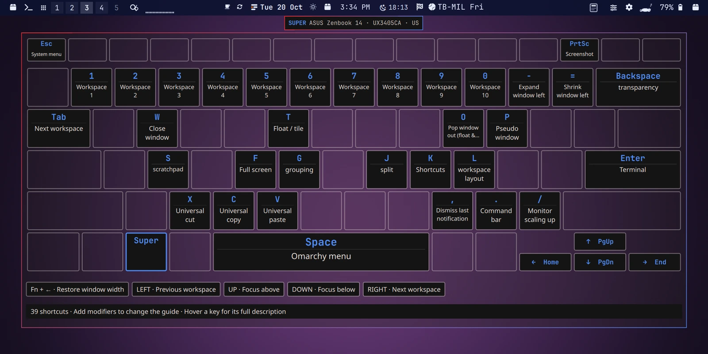
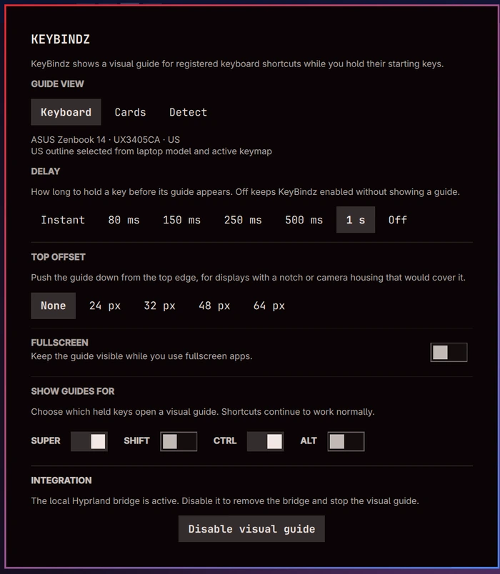

# KeyBindz



A theme-aware keyboard shortcut guide for Omarchy, maintained by **s3pp3ku**.
Hold Super for one second to see your registered shortcuts on a frosted
keyboard overlay. Quick shortcuts finish without showing the guide.

KeyBindz is an independent MIT-licensed fork of
[Omakeez by cyprusad](https://github.com/cyprusad/omakeez). It keeps the upstream
catalog, bridge, consent flow and privacy model, and adds a physical keyboard
view plus local visual refinements.

> **Hardware note:** the custom physical keyboard overlay has only been tested
> on the maintainer's machine and is not known to work on any other machine. The
> tested environment is an ASUS Zenbook 14 UX3405CA with a US layout, running
> Omarchy 4.0.5, Hyprland 0.56.2 and the Akira theme at a 1200x750 logical
> resolution (1.6 scale). It is not guaranteed to fit other laptops, keyboard
> layouts, themes, resolutions or scale factors. Unsupported keyboards use the
> cards fallback instead of the custom overlay. See
> [Compatibility and testing status](#compatibility-and-testing-status).

## What it does

- Shows a physical keyboard view for the Zenbook UX3405CA US deck and highlights
  the shortcuts registered for the held modifier.
- Keeps unused keys transparent, so the frosted desktop remains visible.
- Uses theme-aware menu colors, borders, gradients, radii and opacity.
- Centers key legends and command text, with inline actions on the top row and a
  larger spacebar treatment.
- Defaults to a 1 s hold delay, with Instant, 80, 150, 250, 500 ms and 1 s
  options, or Off.
- Enables Super and Ctrl guides by default; Shift and Alt can be added while
  holding an enabled starting key.
- Follows the focused monitor and stays hidden over fullscreen apps by default.
- Never changes the actual shortcut bindings.
- Has no network client, keystroke history, statistics or `/dev/input` access.

## Screenshots

The settings panel:



## Installation

### Requirements

- Omarchy with its Lua-based Hyprland configuration and Quickshell.
- Hyprland 0.56.2 or newer. The fork was validated on Omarchy 4.0.5.
- A working Omarchy bar. KeyBindz is added as a bar widget plus service.

### Add the plugin

```sh
omarchy plugin add https://github.com/s3pp3ku/KeyBindz.git --enable
```

Open the KeyBindz keyboard icon in the bar. The setup panel shows the small
Hyprland bridge block that KeyBindz needs; review it and enable the visual
guide. The bridge only observes the allowlisted modifier/key transitions needed
for the guide.

If you are switching from Omakeez, disable Omakeez first. KeyBindz uses its own
plugin ID, bridge marker, event protocol and state directory.

### Enable the frosted backdrop

Add this to `~/.config/hypr/looknfeel.lua` and reload Hyprland:

```lua
hl.layer_rule({
  match = { namespace = "^keybindz-guide$" },
  blur = true,
  xray = false,
  ignore_alpha = 0.01,
})
```

Blur must also be enabled in the compositor settings. Without the layer rule the
guide still works, but the backdrop is not frosted.

### Update

```sh
omarchy plugin update io.github.s3pp3ku.keybindz --yes
omarchy-restart-shell
```

The updater uses a fast-forward Git merge and refuses conflicting local changes.
Commit or back up local modifications before updating.

A more detailed guide, including uninstalling and troubleshooting, is in
[docs/INSTALL.md](docs/INSTALL.md).

## Configuration

Preferences live in KeyBindz's entry in `~/.config/omarchy/shell.json`, separate
from the repository. Drawer-hosted widgets use the top-level `plugins` entry.
Example:

```json
{
  "id": "io.github.s3pp3ku.keybindz",
  "guideView": "keyboard",
  "guideDelayMs": 1000,
  "guideTopOffset": 0,
  "guideSuperEnabled": true,
  "guideCtrlEnabled": true,
  "guideShiftEnabled": false,
  "guideAltEnabled": false,
  "showInFullscreen": false
}
```

The settings panel exposes the same options. `guideView` can be `keyboard` or
`cards`; the cards view is the fallback for keyboards that do not match the
tested deck. `guideTopOffset` pushes the guide down for a notch or camera
housing.

## Project history

### Omakeez

[Omakeez](https://github.com/cyprusad/omakeez) by
[cyprusad](https://github.com/cyprusad) is the original local-first Omarchy
shortcut guide. It provides the shortcut catalog, Hyprland Lua bridge, consent
and safe configuration patching, lock/fullscreen suppression, focused-monitor
routing, and the privacy-first design that KeyBindz still uses. Its 0.1.x
releases and design notes are retained in [docs/upstream](docs/upstream) and
[docs/upstream/CHANGELOG.md](docs/upstream/CHANGELOG.md).

### KeyBindz

KeyBindz was forked from Omakeez on 2026-10-19. The fork keeps the upstream
plumbing and replaces the generic card canopy with a physical keyboard deck for
the author's laptop. Later local work added:

- the Zenbook UX3405CA US key geometry and hardware/layout detection;
- theme-aware charcoal keycaps, transparent unused keys and keycap rounding;
- centered legends and commands, a proportional command face and a larger
  spacebar treatment;
- a 1 s default hold delay and the current delay/top-offset controls;
- compact inline actions for the half-height top row, including Esc and PrtSc.

The fork is maintained as a personal project. Upstream Omakeez changes are
incorporated deliberately rather than by replacing the custom keyboard view.

## Compatibility and testing status

**The custom keyboard overlay is tested on one machine only and is not claimed
to work on any other machine.** The maintainer's environment is:

| Component | Tested value |
|---|---|
| Laptop | ASUS Zenbook 14 UX3405CA |
| Keyboard | US layout, Zenbook UX3405CA deck |
| Omarchy | 4.0.5 |
| Hyprland | 0.56.2 |
| Theme | Akira |
| Display | eDP-1, 1920x1200 physical, 1.6 scale, 1200x750 logical |

Other hardware, layouts, themes, resolutions or scale factors may produce
misaligned keys, clipped labels or a deck that does not match the physical
keyboard. KeyBindz is not affiliated with ASUS or Omarchy. Use `Cards` in the
settings panel if the keyboard view does not match your machine. Reports and
patches are welcome, but this is not a supported cross-device product.

## Privacy

KeyBindz does not record what you type and does not send anything over the
network. Runtime metadata lives in
`${XDG_STATE_HOME:-$HOME/.local/state}/omarchy/keybindz/` and contains the
generated shortcut catalog and bridge-control backups. Hardware detection reads
DMI/sysfs metadata and the active Hyprland layout; it does not read input-device
events. See [docs/upstream/SECURITY.md](docs/upstream/SECURITY.md) for the
upstream boundary.

## Development

```sh
PATH=/usr/lib/qt6/bin:$PATH sh tests/shell/run all
```

The tests cover catalog generation, bridge behavior, safe configuration changes,
guide filtering, keyboard layout and hardware detection. For live guide work:

```sh
omarchy-restart-shell
omarchy-shell keybindz-feasibility diagnostics
```

`KeyboardGuide.qml` and `SuperGuide.qml` do not reliably hot-reload; restart the
shell after changing them. More local notes, including the live screenshot
recipe and current layout gotchas, are in [AGENTS.md](AGENTS.md).

## Credits and license

- **Omakeez** — original project by
  [cyprusad](https://github.com/cyprusad). The upstream architecture, privacy
  boundary and design documentation are reused under the MIT license.
- **KeyBindz** — fork and keyboard overlay by
  [s3pp3ku](https://github.com/s3pp3ku).
- Both copyright notices are retained in [LICENSE](LICENSE).

KeyBindz is released under the MIT license. If you redistribute it, keep the
upstream attribution and the license notice.
